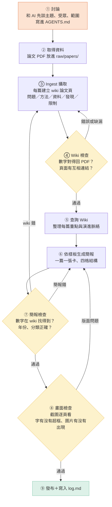

# 嘉義大學 11211175 財金碩 江芸瑄 用 LLM Wiki 做死亡率模型教學簡報

---

## 一、LLM Wiki 主題與簡介

**主題：死亡率模型的發展：從 Lee-Carter 到機器學習與深度學習**

死亡率預測是壽險、年金、健保與國民年金財務規劃的基礎。這個 Wiki 收錄 **20 篇論文**（另含 1 份附錄），整理死亡率模型三十年來的演進：

| 類別 | 篇數 | 代表論文 |
|---|---|---|
| 傳統隨機模型 | 6＋概念頁 | Lee-Carter（1992，概念頁）、Brouhns（2002）、CBD（2006）、Renshaw & Haberman（2006）、Cairns 等（2007）、Plat（2009）、O'Hare & Li（2012） |
| 機器學習（樹模型） | 5 | Deprez（2017）、Levantesi & Pizzorusso（2019）、Levantesi 等（2020，綜述）、Bjerre（2022）、Qiao & Wang（2024） |
| 深度學習 | 3 | Hainaut（2018）、Nigri 等（2019）、Schnürch & Korn（2021） |
| 台灣研究 | 6 | 生育率推估（2002）、縣市人口推估（2010）、規律折扣數列（2011）、婚姻與死亡率（2014）、高齡模型比較（2016）、台灣資料模型比較（2019） |

**Wiki 結構**（依 Karpathy LLM Wiki 的三層架構）：

```
LLM Wiki Notes/
├── AGENTS.md        ← 規則：主題、受眾、攝取步驟、簡報規範
├── raw/papers/      ← 原始論文 PDF（不修改）
├── assets/          ← 簡報插畫
└── wiki/
    ├── index.md     ← 全部頁面目錄
    ├── log.md       ← 每次操作紀錄
    ├── papers/      ← 20 篇論文頁：背景問題、方法、實驗結果、限制、文獻脈絡
    ├── concepts/    ← 11 個概念頁（Lee-Carter、GAPC、LSTM、CNN…）
    ├── synthesis/   ← 1 個跨論文統整頁
    └── presentations/ ← 教學簡報
```

每篇論文頁固定五段：研究背景與問題 → 核心方法 → 實驗成果 → 限制與反思 → 文獻脈絡（用 `[[連結]]` 串起前後論文）。

**Wiki 連結：**https://github.com/yun0215973/mortality-llm-wiki

---

## 二、教學 HTML 簡報

**簡報連結：** https://yun0215973.github.io/mortality-llm-wiki/wiki/presentations/mortality_ml_dl_presentation_v9.html

**受眾：** 沒學過死亡率模型的大學生
**頁數：** 38 頁，鍵盤 ← → 或空白鍵換頁

**教學結構：**

1. **先看全貌（第 3 頁）**：三十年演進時間軸，讓學生知道每篇論文在故事裡的位置
2. **核心公式（第 5 頁）**：用白話解釋 Lee-Carter 的 α、β、κ 三個參數
3. **一篇一張卡（19 張＋Lee-Carter 概念頁）**：每張固定四格，分別是「想解決什麼問題」「怎麼做」「發現了什麼」「還做不到什麼 → 下一篇接手」。最後一格連到下一篇，讓 20 篇論文串成一個「一路補洞」的故事
4. **章節小結**：傳統模型比較表、AI 三條路線（修正／換零件／直接預測）
5. **比較與結論**：五類方法比較表、解釋性 vs 精度取捨圖、選型建議

**Wiki 與簡報的對應：** 每張投影片底部都標示來源論文，每張論文卡對應 Wiki 中的一個論文頁。

---

## 三、Loop / Graph 設計



```
① 討論 → ② 取得資料 → ③ Ingest → ④ Wiki 檢查 ⟲ ③
  → ⑤ 查詢 Wiki → ⑥ 依樣板生成簡報 → ⑦ 簡報檢查 ⟲ ⑥ 或 ③
  → ⑧ 畫面檢查 ⟲ ⑥ → ⑨ 發布＋寫入 log.md
```

| 節點 | 做什麼 | 會不會重複 |
|---|---|---|
| ① 討論 | 先和 AI 談主題、受眾、範圍，寫進 AGENTS.md 才開始生成 | 只做一次 |
| ② 取得資料 | 論文 PDF 放進 raw/papers/（不放對話附件，避開 20MB 上限） | 新增論文時 |
| ③ Ingest | 每篇建一個論文頁，固定五段格式 | **每篇論文重複一次** |
| ④ Wiki 檢查 | 頁面數字對得回 PDF？有連到相關頁面？ | **不通過就回到 ③** |
| ⑤ 查詢 Wiki | 整理各篇重點與前後關係 | 每次做簡報 |
| ⑥ 生成簡報 | 依 v7 樣板，一篇一張卡 | **不通過就重做** |
| ⑦ 簡報檢查 | 投影片上的數字在 Wiki 找得到？年份、分類正確？ | 錯在 Wiki 回 ③，錯在簡報回 ⑥ |
| ⑧ 畫面檢查 | 逐頁截圖：字有沒有超框、圖片有沒有出現 | **不通過回 ⑥** |
| ⑨ 發布 | 上傳並在 log.md 記一筆 | 每個版本 |

**為什麼這樣設計：**

- **檢查分三關（④⑦⑧）**：內容錯誤和版面錯誤是兩種不同的問題，分開檢查才知道要回哪一步修。
- **⑦ 失敗時分兩條路回去**：如果錯在 Wiki，只改簡報會讓下次生成又錯，所以要回 ③ 修正源頭。
- **用樣板生成（⑥）**：讓 AI 每次都從頭設計版面，品質不穩定（v1～v3 都有版面問題）。固定樣板之後，AI 只負責填內容。

---

## 四、實際執行與檢查紀錄

**工具分工：**
- Google Antigravity：建立 Wiki、攝取論文、產生簡報 v1～v3
- Claude：v4～v9 重新設計簡報樣板；v9 依 Wiki 的 20 篇論文頁、概念頁重寫內容，Wiki 有錯處依 PDF 更正，並做內容、數字與畫面檢查

| 版本 | 檢查節點 | 發現的問題 | 處理 |
|---|---|---|---|
| v2 | ⑧ 畫面 | 版面很醜，文字和圖片分散在不同頁 | 要求 AI 修改，產生 v3 |
| v3 | ⑧ 畫面 | 黑色主題不適合教學、圖片太大、公式沒顯示 | 換成固定樣板（v4、v5） |
| v3 | ⑦ 簡報 | **MAE 長條圖的數字沒有任何來源**（AI 自己編的） | 刪除，改成依高／中／低評等畫的定性取捨圖 |
| v3 | ⑦ 簡報 | 錯字「解重性」 | 改為「解釋性」 |
| v3 | ⑦ 簡報 | CNN 和 LSTM 兩頁用同一張圖 | 改成每頁不同插畫 |
| v3→v6 | ⑦ 簡報 | 「Deep Learning Integrated Lee-Carter」被寫成 **2023 年 CNN 論文**；查證後是 **Nigri 等 2019 年、用 LSTM** | 更正 |
| v3→v6 | ⑦ 簡報 | Schnürch & Korn 被歸到 LSTM；查證後實際用 **CNN** | 更正 |
| v3→v7 | ⑦ 簡報 | 台灣頁寫「Yue 2003 生育率與死亡率關聯」；讀 PDF 後是**黃意萍、余清祥 2002 年**的生育率推估研究 | 更正 |
| v3→v7 | ⑦ 簡報 | 「Wang & Yue 2011 DSW 模型」：2011 年那篇是**規律折扣數列（DS）**，DSW 是 2016 年才出現 | 更正 |
| v3→v7 | ⑦ 簡報 | 「2024 多因子機器學習」對不上任何一篇論文 | 暫時刪除，待補 |
| v5 | ⑧ 畫面 | 插畫一直不出現：簡報在 wiki/presentations/，assets 在專案根目錄，`../assets/` 少了一層 | 改為自動搜尋路徑，最後直接把圖片嵌入 HTML |
| v6 | ⑦ 內容 | 20 篇論文只介紹了 11 篇，台灣研究只有一句話 | 補齊 20 張論文卡，台灣研究獨立成章（v7） |
| v7 | ⑦ 數字檢查 | 逐頁比對論文卡上的數字與原始資料：**47 個數字，43 個找得到**；剩下 4 個都是「→ 下一篇」連結中的年份，不是錯誤 | 通過 |
| v7 | ⑧ 畫面 | 37 頁逐頁截圖：參考文獻頁超出頁尾 | 拆成國外、台灣兩頁 |
| v7 | ⑦ 對照 Wiki | 拿 v7 對照 Wiki 的 index 和統整頁：2020 Levantesi 在 Wiki 裡是**綜述論文**，v7 卻寫成另一篇隨機森林研究；Wiki 收錄的 **2024 Qiao-Wang** 在 v7 漏掉 | v8 改寫 2020 卡片、補上 2024 卡片 |
| v7 | ⑦ 對照 Wiki | 9 張論文卡原本依論文摘要撰寫，沒有對照 Wiki | v8 全部改依 Wiki 統整頁與概念頁內容重寫 |
| v8 | ④ Wiki 對照 PDF | **Wiki 本身有錯**：生育率論文頁寫「余清祥、2003、第 26 期、1971–2000 年資料、比較 Hadwiger 與 Gamma」，但 PDF 是**黃意萍、余清祥，第 25 期、民國 91 年（2002）**，用 1951–1995 建模、1996–2000 驗證，比較的是 Gamma、Gompertz、Lee-Carter 與個別估計法 | 簡報依 PDF；**Wiki 要回頭修** |
| v8 | ④ Wiki 對照 PDF | Wiki 說 2011 年論文「結合韋伯分布創立 DSW」，但 2011 年 PDF 全文**沒有韋伯分布與 DSW**；DSW 出現在 2016 年論文 | 簡報改正；**Wiki 要回頭修** |
| v8 | ④ Wiki 對照 PDF | 2019 李永琮等人：統整頁寫「女性 M9 最佳」、論文頁寫「女性 M9 與 M10 領先」，PDF 摘要寫的是 **女性 M10 最佳** | 簡報依 PDF；**Wiki 要回頭修** |
| v8 | ④ Wiki 內部一致性 | 同一篇論文在不同頁數字不一致：Nigri 誤差降幅（統整頁 40%–91%、LSTM 頁 41%–91%）；RH 資料期間（統整頁 1841–2000、論文頁 1961–2003） | 簡報採論文頁與概念頁；**Wiki 要統一** |
| v8 | ⑦ 數字檢查 | 簡報正文 135 個數字：126 個在 Wiki 找得到，其餘為期刊期數、時間軸年份範圍與依 PDF 更正的年份 | 通過 |
| v8→v9 | ⑦ 對照論文頁 | 拿到 20 篇論文頁後發現：**統整頁和論文頁互相矛盾**。例如 Brouhns 資料期間（統整頁 1903–1996、論文頁 1960–1998）、CBD（1947–2002 vs 1961–2002）、Levantesi 2019 國家（義西加 vs 義大利）、Hainaut 國家（美英法比 vs 法英美）、Qiao 誤差降幅（近半 vs 30%–50%）、Bjerre 的 53%（梯度提升概念頁說是純 GB 的勝率，論文頁說是純 LC 贏過 LC＋RF 的比例） | v9 全部改依**論文頁**；統整頁是二手摘要，**Wiki 要統一** |
| v9 | ⑦ 數字檢查 | 簡報正文 183 個數字：**179 個在 Wiki 論文頁或概念頁找得到**；4 個不在 Wiki：時間軸年份範圍、「1,000 次」的拆字，以及依 PDF 更正的生育率建模年份 1951、1995 | 通過，沒有無來源數字 |
| v9 | ⑧ 畫面 | 38 頁逐頁截圖：Bjerre 那頁文字超出頁尾、壓到插畫 | 精簡文字後通過 |

---

## 五、反思

**1. 哪一個節點最常出錯？**

**⑥ 生成簡報**最常出錯，而且錯誤類型很危險：
- **捏造數字**：v3 的 MAE 長條圖，數字在 Wiki 和論文裡都找不到
- **張冠李戴**：把 LSTM 論文寫成 CNN 論文、年份寫錯、論文標題對到錯的研究
- **偷懶省略**：攝取了 20 篇，簡報卻只講 11 篇，每篇只有一行關鍵字

這些錯誤看起來都很像真的。不回頭對照原文，很難發現。

**2. 把檢查往前移到哪裡？**

- 原本只在簡報做好後「看起來對不對」。現在把「**數字必須能在 Wiki 論文頁找到**」寫進 AGENTS.md 的簡報規範。AI 在⑥生成時就受這條限制，⑦再逐頁比對。
- 更往前到 **④ Wiki 檢查**：v8 拿 Wiki 對照 PDF，發現 Wiki 本身就有 3 處錯誤（論文年份、DSW 歸屬、女性最佳模型），還有統整頁和論文頁互相矛盾。這代表 **③ Ingest 也是錯誤的源頭**：AI 攝取時會「腦補」看起來合理的內容。所以檢查要提前到攝取完成當下：每篇論文頁的年份、資料期間、主要結論，都要回頭對照 PDF 原文才算通過。

**3. 有沒有修改 workflow / graph？**

有，改了四處：

- **新增「依樣板生成」**：v1～v3 讓 AI 每次自由設計，版面一直不穩定。改成先做好一份樣板（v7），把版面規則寫進 AGENTS.md。之後 AI 只填內容，不動樣板的版面與程式。
- **⑦ 失敗時分兩條路**：原本發現錯誤就直接改簡報。後來發現有些錯誤（例如台灣論文年份）源頭在 Wiki，只改簡報下次生成還會再錯，所以加了「錯在 Wiki → 回 ③ 修正源頭」這條路。
- **簡報只引用論文頁，不引用統整頁**：統整頁是 AI 對論文頁的再摘要，v9 發現它會把數字、國家、年份改錯（「摘要的摘要」會失真），所以簡報的數字一律回到論文頁，統整頁只用來排章節順序。
- **④ Wiki 檢查加上「對照 PDF」**：原本只檢查頁面格式和連結，現在每篇論文頁的年份、資料期間、主要結論都要對照 PDF 原文。因為 v8 發現 Wiki 本身會錯，而簡報是從 Wiki 生成的，源頭錯了，後面再怎麼檢查簡報都抓不到。
