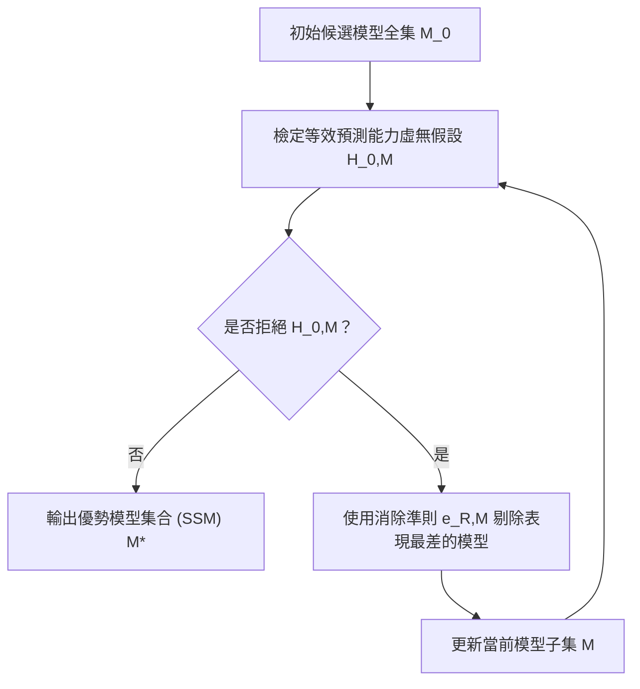

# 模式信賴集合 (Model Confidence Set, MCS)

## 一、 概念定義與理論背景

**模式信賴集合 (Model Confidence Set, MCS)** 是由 Peter R. Hansen、Asger Lunde 與 James M. Nason 於 2011 年發表於《*Econometrica*》的先進模型選擇與統計檢定程序。

在預測科學、計量經濟學與精算模型評估中，研究者傳統上習慣依賴如均方根誤差 (RMSE)、平均絕對百分比誤差 (MAPE) 或貝氏資訊準則 (BIC) 等「單點估計 (Point Estimates)」。然而，單點指標無法解答關鍵的統計問題：**「模型 A 的 RMSE 略低於模型 B，這究竟是統計上的顯著優勢，還是僅僅由隨機噪音導致的運氣？」**

MCS 克服了此盲點。在給定使用者設定的顯著水準 $\alpha$（例如 $20\%$，對應 $1-\alpha = 80\%$ 信心水準）下，MCS 會自動輸出一個**「優勢模型集合 (Superior Set of Models, SSM)」**，保證最佳模型以至少 $1-\alpha$ 的機率包含於該集合中。

---

## 二、 演算法流程與統計檢定機制

MCS 採用循序消除演算法 (Sequential Elimination Procedure)：

1. **損失函數定義**：針對模型 $i$ 在時間 $t$ 之預測損失設為 $L_{i,t}$，兩模型間之相對損失差異為：
   $$d_{ij,t} = L_{i,t} - L_{j,t}, \quad \forall i, j \in \mathcal{M}$$
2. **等效預測能力虛無假設 (Equal Predictive Ability, EPA)**：
   $$H_{0,\mathcal{M}}: \mathbb{E}[d_{ij,t}] = 0, \quad \forall i, j \in \mathcal{M}$$
3. **檢定統計量**：利用區塊自助重抽法 (Block Bootstrap) 構建極大化 $t$ 統計量 $T_{\max,\mathcal{M}}$ 或平均化統計量 $T_{R,\mathcal{M}}$。
4. **剔除規則**：若 $p$ 值小於預設顯著門檻 $\alpha$，拒絕虛無假設，並將標準化相對損失最大（即表現最差）的模型自 $\mathcal{M}$ 中剔除，重複此步驟直至 $H_0$ 無法被拒絕。

---

## 三、 文獻引用與實證案例

- **奠基文獻**：Hansen, P.R., Lunde, A. and Nason, J.M. (2011). *The model confidence set*. Econometrica, 79(2), 453–497.
- **精算與死亡率預測實證**：
  - 在 [[2022-tree-based-mortality]] 中，作者利用 MCS 評測全球 33 國 66 組死亡率序列，證明在多數情境下，**純樹狀模型 (Pure GB / Pure RF) 顯著進駐優勢模型集合 (SSM)**，統計上直接擊敗了以 [[李-卡特模型 (Lee-Carter Model, 1992)]] 為首的傳統隨機模型。
