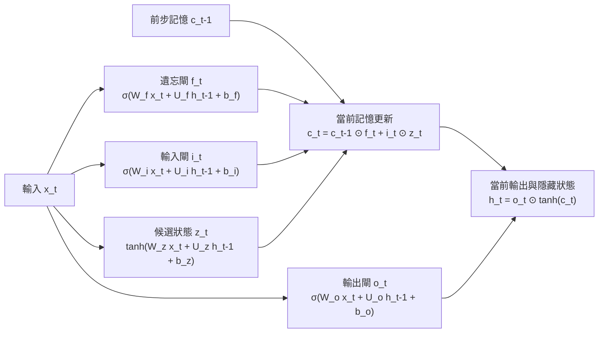

# 長短期記憶網路 (Long Short-Term Memory, LSTM)

## 一、 核心概念與理論機制

**長短期記憶網路 (Long Short-Term Memory, LSTM)** 是由 Sepp Hochreiter 與 Jürgen Schmidhuber 於 1997 年提出之特殊循環神經網路 (RNN) 架構。

傳統 RNN 在處理長序列時，反向傳播過程中的梯度會以指數級速度衰減或爆炸（梯度消失/爆炸問題），導致模型喪失捕捉長程時間依賴的能力。LSTM 藉由引入**「細胞狀態 (Cell State)」**與三個可微分的**「邏輯閘門 (Gates)」**，建立了能夠按需記住或遺忘信息的長效記憶機制。

---

## 二、 死亡率時間序列預測中的關鍵突破

在人口統計與精算學中，預測總體死亡趨勢參數 $\kappa_t$ 傳統上依賴 Box-Jenkins 的 ARIMA 模型。但 ARIMA 假設變異數恆定且外推呈現僵化直線，無法捕捉如二戰後改善加速或近年減緩的非線性動態。

- **替代 ARIMA 成為非線性時間引擎**：在 [[2019-nigri-deep-learning-lc]] 中，作者利用單層 LSTM 搭配 ReLU 激勵函數對全球 6 國歷史 $\kappa_t$ 進行預測，實證證明在測試集上**外推均方根誤差 (RMSE) 較最佳 ARIMA 降低 41% 至 91%**，且無需人為主觀截斷歷史噪訊年份。
- **後續演進**：在 [[2020-levantesi-longevity-ml]] 綜述中被肯定為將深度學習序列處理能力成功融合進經典精算結構的代表性技術。
