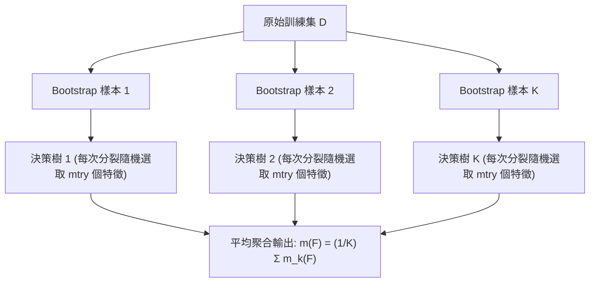

# 隨機森林 (Random Forests)

## 一、 核心概念與演算法原理

**隨機森林 (Random Forests, RF)** 是由 Leo Breiman 於 2001 年提出之基於決策樹的經典整合學習 (Ensemble Learning) 演算法。

隨機森林的核心直覺是**「隨機化雙重去相關性 (Double Randomization & De-correlation)」**，在拔靴聚合 (Bagging) 的基礎上增加了特徵層級的隨機抽樣，從而大幅降低單一決策樹高變異數 (High Variance) 造成的過擬合風險。

### 雙重隨機機制
1. **樣本隨機抽樣**：每棵樹皆基於自原始樣本進行有放回抽樣 (Bootstrap Sample) 構建，未被抽中的袋外數據 (Out-Of-Bag, OOB) 可作為獨立驗證集。
2. **特徵隨機抽樣**：在樹的每個內部節點進行分裂時，不從全體 $p$ 個特徵中尋找最佳切分，而是隨機挑選 $mtry \ll p$ 個特徵作為候選。這確保預測力較弱的變數亦有機會被選為分裂依據，防止強特徵主導所有樹而產生高度相關性。

---

## 二、 時間序列與精算領域應用演進

傳統隨機森林由於依賴階梯函數分割，無法直接外推包含趨勢 (Trend) 的時間序列。
- **差分轉換解法**：在 [[2022-tree-based-mortality]] 中，研究者透過「一階對數差分」成功將時間序列轉為弱平穩序列，並設定 $ntree=200, mtry=2, maxnodes=16$ 嚴密防範過擬合。
- **可解釋性挖掘**：結合 `inTrees` 演算法，隨機森林之終端條件可有效揭示如「1969 年香港流感爆發」與「東歐前蘇聯集團高齡死亡停滯」等複雜時空互動特徵。
