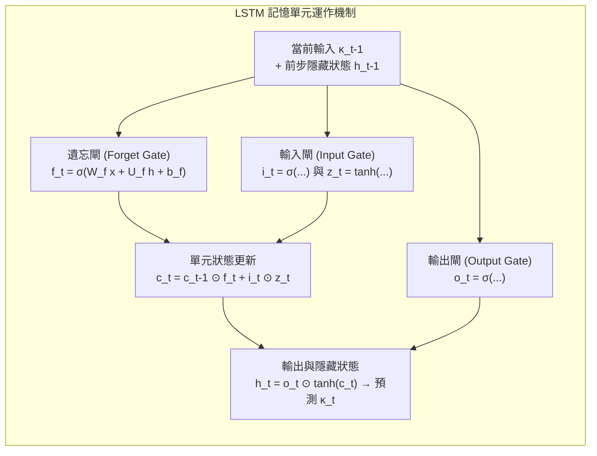

# 深度學習整合李-卡特模型：基於長短期記憶網路之時間指數預測 (A Deep Learning Integrated Lee–Carter Model)

> **論文出處**：*Risks*, 7(1), 33. DOI: [10.3390/risks7010033](https://doi.org/10.3390/risks7010033)  
> **作者**：Andrea Nigri, Susanna Levantesi, Mario Marino, Salvatore Scognamiglio, Francesca Perla  
> **本機存檔**：`raw/papers/2019_nigri_deep_learning_lc.pdf`

---

## 一、 研究背景與核心問題意識 (Motivation & Problem Statement)

### 1. 傳統 ARIMA 預測死亡率趨勢的僵化瓶頸
在 [[李-卡特模型 (Lee-Carter Model)]] 的二階段流程中，第一階段利用 SVD 分解出描述時間總體趨勢的指數 $\kappa_t$；第二階段則廣泛採用 Box-Jenkins 的 ARIMA(0,1,0)（帶漂移項隨機漫步）進行未來外推。

然而，ARIMA 流程存在三大難以克服的缺點：
1. **強行假設常數變異數 (Constant Variance)**：長期人口數據往往伴隨劇烈的波動性變異（如醫療革命、戰爭衝擊），違反定常性假設。
2. **線性直線預測脫離現實**：隨機漫步的均值預測本質上是一條直線，無法捕捉非線性的加速改善或減緩走勢。
3. **被迫進行人為主觀歷史資料切除 (Time-chunks Truncation)**：由於 ARIMA 無法處理歷史雜訊過大的年份，精算師往往主觀丟棄 1950 或 1960 年以前的數據，造成歷史長程記憶的嚴重流失。

### 2. 深度學習時間序列之突破契機
循環神經網路 (RNN) 與長短期記憶網路 ([[長短期記憶網路 (LSTM)]]) 具備天然的內部閘門記憶機制，能夠自動保留長期依賴並過濾高頻隨機雜訊，正是取代傳統 ARIMA 過程的最佳候選人。

---

## 二、 核心方法與技術架構 (Methodology & Architecture)

### 1. 模型整合設計：保留幾何曲面，神經化時間外推
本研究**刻意保留** Lee-Carter 原始透過 SVD 估計出的年齡輪廓參數 $a_x$ 與 $b_x$（確保年齡結構的簡約性與生物學合理性），將創新的手術刀**精準集中於時間指數 $\kappa_t$ 的預測機制**。

$$\log(m_{x,t}) = a_x + b_x \kappa_t + \epsilon_{x,t}$$

傳統上使用 ARIMA 模型預測 $\kappa_t$，本文替換為非線性深度 LSTM 映射：
$$\kappa_t = f_{LSTM}(\kappa_{t-1}, \kappa_{t-2}, \dots, \kappa_{t-J}) + e_t$$
（數值實驗中取時間落後期 $J=1$）。

### 2. LSTM 內部閘門機制與監督學習資料集構建

- **監督學習滑動視窗**：將歷史 $\kappa_t$ 序列轉化為 $(n \times J)$ 的輸入矩陣與 $(n \times 1)$ 的目標向量，依 $80\%$ 訓練集與 $20\%$ 測試集嚴格劃分。
- **網路架構**：經超參數微調，單層隱藏層結構搭配 **ReLU (Rectified Linear Unit)** 激勵函數表現最優，遞迴逐步生成未來 $\widehat{\kappa}_{T+\tau}$。

---

## 三、 關鍵實驗成果與評測基準 (Empirical Results & Benchmarks)

1. **全球 6 大代表國數據**：涵蓋澳洲、丹麥、義大利、西班牙、美國、日本等橫跨歐美亞太之完整 HMD 數據，年齡涵蓋 0–100 歲。
2. **對決基準**：與 Hyndman-Khandakar 演算法自動挑選出的**最佳 ARIMA(p,d,q)** 進行外推預測對決。
3. **誤差指標全面壓倒性勝出 (測試集 MAE 與 RMSE)**：

| 國家與性別 | ARIMA 預測 RMSE | LSTM 預測 RMSE | 誤差降低幅度 |
| :--- | :--- | :--- | :--- |
| **義大利男性 (Italy Male)** | 63.46 | **5.48** | **-91.4% (暴跌逾九成)** |
| **澳洲男性 (Australia Male)** | 28.04 | **3.24** | **-88.4%** |
| **西班牙男性 (Spain Male)** | 26.33 | **8.96** | **-66.0%** |
| **美國男性 (USA Male)** | 9.48 | **2.86** | **-69.8%** |
| **日本女性 (Japan Female)** | 17.52 | **10.23** | **-41.6%** |

> **核心實證結論**：在全體 6 國男女共 12 組序列中，**LSTM 在每一組的 MAE 與 RMSE 全數擊敗最佳 ARIMA**。圖形診斷顯示，ARIMA 甚至會產生超出 99.5% 信賴區間的不合理直線，而 LSTM 完美捕捉了非線性減速與死亡改善的真實動態。

---

## 四、 侷限性與批判性反思 (Limitations & Critical Review)

1. **缺乏信賴區間閉式解 (Point Predictions Only)**：
   - 類神經網路天生僅能產出點預測，無法像 ARIMA 自然導出高斯預測區間。雖作者指出未來可結合 Bootstrap 重抽法補足，但計算成本隨之巨幅攀升。
2. **單一步驟遞迴誤差累積**：若落後步數較大或外推超過 30 年，神經網路遞迴輸出可能出現數值漂移。

---

## 五、 文獻脈絡與演進關係 (Lineage & Related Work)

- **承接自**：[[李-卡特模型 (Lee-Carter Model)]]、Hochreiter & Schmidhuber (1997) LSTM、Hyndman & Khandakar (2008) auto.arima。
- **對標文獻**：與 [[2018-hainaut-neural-analyzer]]（側重曲面自編碼重構）形成鮮明互補，專攻時間維度非線性。
- **被後續綜述高度評價**：在 [[2020-levantesi-longevity-ml]] 中被列為現代深度學習與精算模型融合的最佳典範之一。
- **跨論文深度對比**：收錄於 [[隨機死亡率模型與機器學習技術演進對比統整]]，分析 LSTM 時間序列與傳統 ARIMA 在死亡率外推中的本質差異。
