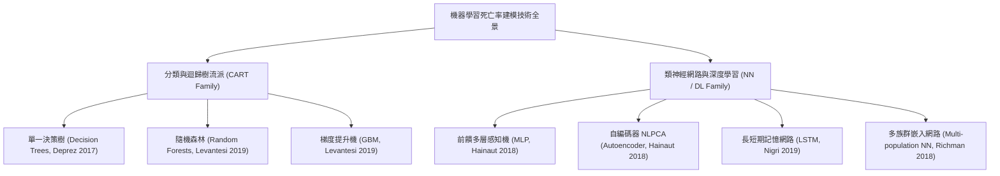

# 機器學習於長壽風險管理之應用現況綜述 (Longevity risk management through Machine Learning: state of the art)

> **論文出處**：*Insurance Markets and Companies*, 11(1), 11–20. DOI: [10.21511/ins.11(1).2020.02](http://dx.doi.org/10.21511/ins.11(1).2020.02)  
> **作者**：Susanna Levantesi, Andrea Nigri, Gabriella Piscopo  
> **本機存檔**：`raw/papers/2020_levantesi_longevity_ml.pdf`

---

## 一、 研究背景與核心問題意識 (Motivation & Problem Statement)

### 1. 人工智慧在保險業的「非壽險 vs. 壽險」發展失衡
根據德勤 (Deloitte 2018) 與歐洲金融管理協會 (EFMA) 的調查，保險業將風險管理視為人工智慧 (AI) 影響最大的領域（$56\%$ 受訪者認同，遠高於銀行業的 $29\%$）。然而在實務發展上，AI 在財產險、車險（非壽險核保、詐欺偵測）早已大放異彩，**但在壽險與年金之「長壽風險管理 (Longevity Risk Management)」中，AI 應用仍處於嚴重低度開發 (Underdeveloped) 狀態**。

### 2. 壽險精算的核心瓶頸
保險公司管理具備長期保證與終身領取特性的年金契約與長照保單時，多數精算師仍死守 1990 年代建立的經典人口統計推估框架。面對日益龐大、多維度的人口與醫療數據，學界與業界迫切需要一份**權威性全景綜述，梳理樹狀模型 (CART) 與類神經網路 (NN) 如何具體賦能死亡率預測與長壽衍生品定價**。

---

## 二、 核心技術架構與方法論分類體系 (Methodology & Taxonomy)

作者將當時文獻中的 AI/ML 精算應用歸納為兩大主流技術流派與三大整合哲學：

### 三大整合哲學
1. **外掛殘差校正法 (Residual Calibration / Complementary Framework)**：
   - 代表：Deprez et al. (2017)、[[2019-levantesi-pizzorusso-ml]]、Levantesi & Nigri (2019)。
   - 核心思想：將經典模型（如 Lee-Carter, Renshaw-Haberman, Plat）視為主結構，利用樹模型學習死亡率殘差比值 $\psi_x = \frac{D_x}{d_x^{mdl}}$，保留傳統模型之可解釋性。
2. **非線性降維替代法 (Non-linear Manifold Substitution)**：
   - 代表：[[2018-hainaut-neural-analyzer]]。
   - 核心思想：以神經網路自編碼器取代傳統 SVD/PCA，直接提取非線性潛在特徵。
3. **時間序列深度序列化 (Time-Series Neuralization)**：
   - 代表：[[2019-nigri-deep-learning-lc]]。
   - 核心思想：維持經典空間輪廓，以 LSTM 取代傳統 ARIMA(0,1,0) 進行 $\kappa_t$ 預測。

---

## 三、 關鍵實證文獻統整與比較 (Synthesis of Literature Findings)

| 文獻 | 採用之 ML 模型 | 基準模型 (Baseline) | 實驗數據集 | 核心結論與效益 |
| :--- | :--- | :--- | :--- | :--- |
| **Deprez et al. (2017)** | 迴歸樹 Boosting | LC, RH 模型 | 瑞士人口 (0–97 歲) | 成功利用樹模型診斷傳統模型在特定年齡與死因上的系統性缺陷。 |
| **[[2019-levantesi-pizzorusso-ml]]** | DT, 隨機森林, GBM | LC, RH, Plat | 義大利人口 (0–100 歲) | 隨機森林在殘差校正上最優，外推預測 RMSLE 改善超過 70%。 |
| **Levantesi & Nigri (2019)** | 隨機森林 + 2D P-splines | LC 模型 | 澳、法、義、西、英、美 6 國 | 結合平滑化技術改善李-卡特預測，並實證評估其對 q-forward 衍生品定價之影響。 |
| **[[2018-hainaut-neural-analyzer]]** | 自編碼器 NLPCA (3-2-3) | LC SVD, LC COH | 法國、英國、美國人口 | 非線性特徵提取使外推 SSE 較世代 LC 降低 53%，捕捉非對稱厚尾。 |
| **[[2019-nigri-deep-learning-lc]]** | 循環神經網路 (LSTM) | 最佳 ARIMA(p,d,q) | 澳、丹、義、西、美、日 6 國 | 在所有 6 國男女序列中預測 RMSE 全面大幅擊敗 ARIMA（義大利降幅達 91%）。 |
| **Richman & Wüthrich (2018)** | 深度類神經網路 (Embedding) | 多族群 Lee-Carter | HMD 全球全體國家數據 | 利用神經網路 Embedding 層同時為全球數十國建立強韌的多族群共同預測。 |

---

## 四、 侷限性、風險與未來挑戰 (Critical Review & Future Challenges)

1. **基準風險 (Basis Risk) 與數據不對稱**：
   - 當前所有學術研究皆基於**國家層級總體人口數據 (HMD)**，但保險公司的年金保單具有強烈社經篩選特性。若直接將國家層級訓練出的演算法套用於特定保單組合，將產生巨大的「基準風險 (Basis Risk)」。
2. **缺乏信賴區間的阿基里斯之腱 (Lack of Uncertainty Intervals)**：
   - 深度神經網路大多僅能給出點估計，缺乏精算定價與第 II 類清償能力協定 (Solvency II) 強制要求的隨機變異數與區間估計。
3. **過度擬合與可解釋性之平衡**：過度複雜的網路結構在訓練期完美，但在外推時往往因為過擬合而產生劣於傳統模型的荒謬走勢。

---

## 五、 文獻脈絡與演進關係 (Lineage & Related Work)

- **承接與總結**：集結了 2017–2019 年間歐洲精算學界（以義大利與瑞士學者為核心）將機器學習導入死亡率建模的全部精華成果。
- **對照文獻**：為兩年後 [[2022-tree-based-mortality]]（Bjerre 2022）提出「放棄傳統模型殘差，改採純樹狀差分外推」提供了最完整的反思與對比立足點。
- **跨論文深度對比**：收錄於 [[隨機死亡率模型與機器學習技術演進對比統整]]，探討長壽風險下不同機器學習範式之監理與實務落差。
