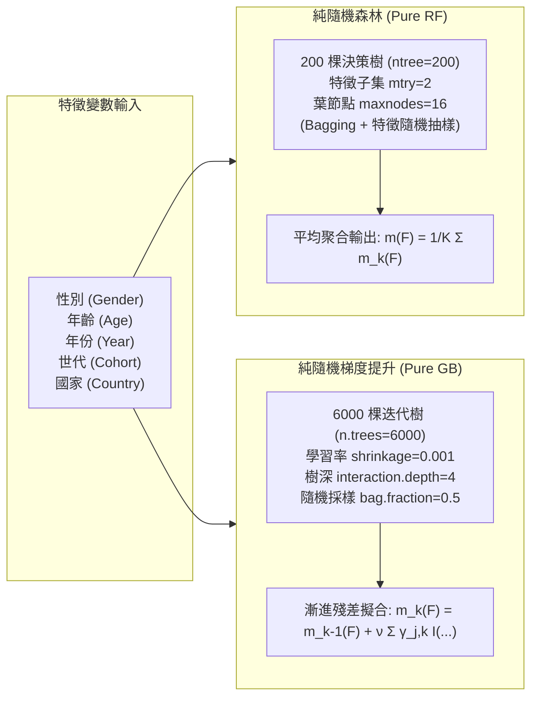
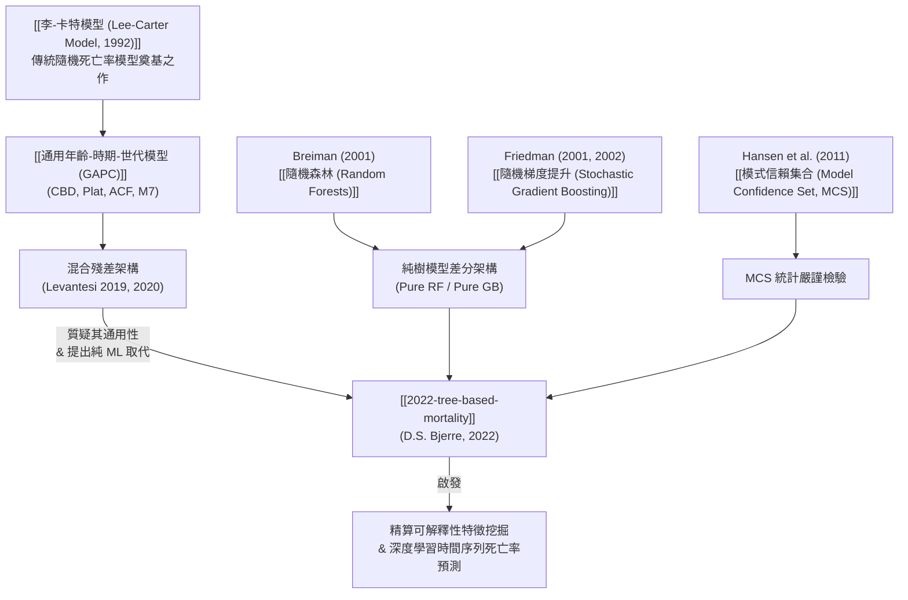

# 基於樹模型之機器學習死亡率建模與預測 (Tree-Based Machine Learning Methods for Modeling and Forecasting Mortality)

> **論文出處**：*Astin Bulletin*, 52(3), 765–787. DOI: [10.1017/asb.2022.11](https://doi.org/10.1017/asb.2022.11)  
> **作者**：Dorethe Skovgaard Bjerre (丹麥奧胡斯大學經濟與商業經濟學系 / CREATES)  
> **本機存檔**：`raw/papers/2022_tree_based_mortality.pdf`

---

## 一、 研究背景與核心問題意識 (Motivation & Problem Statement)

### 1. 傳統隨機死亡率模型的致命瓶頸
在精算學與人口統計學中，評估長壽風險（Longevity Risk）與死亡率預測對於年金基金、人壽保險公司與政府財政至關重要。過去數十年，學界主要依賴以 [[李-卡特模型 (Lee-Carter Model, 1992)]] 為代表的**隨機死亡率模型 (Stochastic Mortality Models)**，並透過年齡 (Age)、時期 (Period/Time) 與世代 (Cohort) 的線性分解進行時間序列 (ARIMA) 推估。

然而，傳統方法存在兩大關鍵缺陷：
1. **結構性先驗假設過強**：強行預設年齡與時間之間的線性或固定相乘結構，無法捕捉複雜的非線性特徵交互作用。
2. **無法擬合「死亡率改善旋轉 (Rotation)」現象**：已開發國家近年來出現「年輕人口死亡率改善減緩、高齡人口改善加速」的現象（Li et al., 2013），傳統模型結構過於僵化，無法彈性適應這種跨年齡層的轉移。

### 2. 機器學習引入精算領域的爭議與痛點
近年研究嘗試將機器學習（如神經網路、樹狀模型）引入死亡率預測，但精算界與人口統計學者仍對其持保留態度，主要原因在於：
- **「黑盒子 (Black Box)」問題**：缺乏可解釋性 (Interpretability)，監管機構與精算師難以理解特徵決策背後的人口統計學與生物學意義。
- **混合模型的片面性**：過去文獻（如 Deprez et al., 2017; Levantesi and Pizzorusso, 2019）大多僅將機器學習用作傳統模型的「殘差校正工具（即 Traditional Model + ML Residuals）」，未曾全面探討**「純機器學習模型 (Pure ML Models)」**是否具備獨立預測死亡率的能力。
- **評測指標缺乏統計檢定**：過去研究多使用 RMSE 或 MAPE 等單一點估計指標，無法在統計上嚴謹證明模型間的預測能力是否存在顯著差異。

---

## 二、 核心方法與技術架構 (Methodology & Architecture)

本研究提出了基於**對數死亡率一階差分**的**純樹狀機器學習架構**，並與 9 種經典傳統模型及多種殘差混合模型進行大規模實證比對。

### 1. 數據特徵與差分前處理 (Differencing Transformation)
死亡力 (Force of Mortality) $\mu_{x,t}$ 在各年齡與年份區間內假設為常數，等同於中央死亡率 $m_{x,t} = \frac{D_{x,t}}{E_{x,t}}$（$D$ 為死亡人數，$E$ 為風險暴露人年數）。

由於樹模型（隨機森林與梯度提升）的分割節點基於訓練集門檻，**無法直接外推具趨勢性 (Trending) 的時間序列數據**。為解決此問題，作者採用一階差分將對數死亡率轉為弱平穩序列 (Trend-Stationary)：
$$\Delta \ln m_{t+h} = \ln m_{t+h} - \ln m_{t+h-1}$$

在完成差分預測後，透過滾動累積反轉換回原始尺度的對數死亡率預測：
$$\ln \widehat{m}_{t+H} = \ln m_t + \sum_{h=1}^{H} \Delta \widehat{\ln m}_{t+h}$$

- **特徵集合 (Features)**：嚴格限制為性別 (Gender)、年齡 (Age)、年份 (Year)、世代 (Cohort, $t-x$) 與國家 (Country)，以確保與傳統模型的比較基準一致。

### 2. 兩大純樹狀機器學習模型 (Pure Tree-Based Models)

- **[[隨機森林 (Random Forests)]] (Pure RF)**：
  - 建立 $K=200$ 棵迴歸樹，每次分裂候選特徵數 $mtry=2$。
  - 為避免過擬合，限制每棵樹之終端節點上限 $maxnodes=16$。
- **[[隨機梯度提升 (Stochastic Gradient Boosting)]] (Pure GB)**：
  - 迭代樹數 $n.trees=6000$，學習率 $\nu=0.001$，樹深 $depth=4$，每次取 $50\%$ 樣本隨機抽樣 (Stochastic Subsampling)，採 5 折交叉驗證 (5-fold CV)。

### 3. 對比的傳統隨機模型與殘差混合流程 (Hybrid Procedure)
研究納入了 9 種廣義年齡-時期-世代 ([[通用年齡-時期-世代模型 (GAPC)]]) 模型：
1. [[李-卡特模型 (Lee-Carter Model, 1992)]] (LC)
2. [[擴展共同因子模型 (Augmented Common Factor, ACF)]] (Li & Lee, 2005)
3. Cairns-Blake-Dowd 模型 (CBD, 2006)
4. Renshaw-Haberman 世代模型 (RH, 2006)
5. APC 模型 (Currie, 2006)
6. M6 與 M7 模型 (Cairns et al., 2009)
7. Plat 精簡版與完整版模型 (Plat, 2009)

**殘差混合流程 (Procedure 1)**：
1. 擬合傳統模型獲得對數死亡率預測值 $\ln \widehat{m}_{t+h}^{model}$ 與擬合殘差 $r_t^{model} = \ln m_t - \ln \widehat{m}_t^{model}$。
2. 使用 RF 或 GB 擬合殘差：$r_t^{model} \sim gender + age + year + cohort + country$。
3. 將殘差預測疊加回傳統模型：$\ln \widehat{m}_{t+h}^{model, ML} = \ln \widehat{m}_{t+h}^{model} + \widehat{r}_{t+h}^{model, ML}$。

### 4. 模式信賴集合檢定 (Model Confidence Set, MCS)
為了超越傳統 RMSE 單點估計，引入 Hansen et al. (2011) 的 [[模式信賴集合 (Model Confidence Set, MCS)]] 程序：
- 設定 $80\%$ 顯著信賴水準，1000 次 Bootstrap 重抽樣。
- 逐輪進行等預測能力虛無假設 ($H_0$) 檢定，剔除預測表現顯著劣勢者，最終篩選出「**優勢模型集合 (Superior Set of Models, SSM)**」。

### 5. 打開黑盒子：可解釋性萃取技術
為破解精算界對 ML 不透明的疑慮，作者展示了三種可解釋性剖析工具：
1. **變數重要性 (Variable Importance)**：依據分裂時 MSE 減少量評估影響力。
2. **偏依賴圖 (Partial Dependence Plots, PDP)**：檢視特定特徵變數對差分死亡率的非線性邊際效應。
3. **決策分裂規則挖掘 (Variable Split via `inTrees`)**：解析隨機森林中 3,200 個終端條件，抓取出現頻率最高的數值切分點與跨國群聚 (4-way Country Groupings)。

---

## 三、 關鍵實驗成果與評測基準 (Empirical Results & Benchmarks)

### 1. 數據集規模 (Human Mortality Database, HMD)
- 納入全球 **33 個國家**、**男女雙性別**（共 66 組死亡率序列）。
- 設計 4 種訓練期與預測期切分：
  - **Case 1**：訓練 1936–1986 (51年) $\rightarrow$ 預測 1987–2016 (30年) [含二戰衝擊]
  - **Case 2**：訓練 1950–2000 (51年) $\rightarrow$ 預測 2001–2016 (16年)
  - **Case 3**：訓練 1961–1986 (26年) $\rightarrow$ 預測 1987–2016 (30年)
  - **Case 4**：訓練 1975–2000 (26年) $\rightarrow$ 預測 2001–2016 (16年)
- 評估兩種年齡層：退休年金族群 (59–89 歲) 與全成年族群 (20–89 歲)。

### 2. 模型預測能力比對 (MCS 優勢模型集合佔比)
在全體 31 種模型橫向評測中，**純樹狀模型展現壓倒性優勢**：

| 評測情境 (年齡 / 預測期) | 純隨機梯度提升 (Pure GB) | 純隨機森林 (Pure RF) | 傳統最佳模型代表 | 混合殘差模型表現 |
| :--- | :--- | :--- | :--- | :--- |
| **59–89 歲 / 30 年長期 (1961–1986)** | **45%** (列入 SSM) | **27%** | Plat(full): 6%, LC: 3% | GB/ACF: 12% |
| **59–89 歲 / 16 年短期 (1950–2000)** | 20% | **42%** (列入 SSM) | CBD: 0%, LC: 0% | GB/APC: 30% |
| **20–89 歲 / 30 年長期 (1961–1986)** | 24% | **35%** (列入 SSM) | CBD: 12%, Plat: 8% | RF/ACF: 6% |
| **20–89 歲 / 16 年短期 (1950–2000)** | 26% | 24% | CBD: 36% | GB/APC: 2% |

> **核心實證結論 1**：在絕大多數情況下，**純機器學習模型（Pure GB 與 Pure RF）顯著優於所有傳統隨機模型及其機器學習殘差變體**。這證實對死亡率施加過多結構性先驗限制反而會損害長期預測精確度。

### 3. 一對一殘差混合檢定 (Head-to-Head Comparisons)
作者進一步將每種傳統模型與其 RF / GB 殘差改良版進行頭對頭檢驗：
- **推翻前人文獻結論**：過去文獻（如 Levantesi & Pizzorusso, 2019; Levantesi & Nigri, 2020）宣稱「機器學習殘差能系統性改善 Lee-Carter 預測」，但本研究指出該結論**高度依賴於特定國家與全年齡段 (20–89)**。
- 若針對退休高齡段 (59–89 歲)，純李-卡特 (Pure LC) 竟然在 $53\%$ 的情況下打敗了加裝 RF 的殘差版本（RF/LC 僅獲勝 $11\%$）。說明**傳統模型加裝機器學習殘差並非萬靈丹**。

### 4. 打開黑盒子的實證發現 (Opening the Black Box)
透過特徵重要性與 `inTrees` 終端決策規則解析，發現樹模型抓到了極具歷史與流行病學意義的隱藏特徵：
1. **年份 (Year) 捕捉重大歷史衝擊**：分裂點在 1969 年出現顯著峰值，精準對應了 **1968–1969 年香港流感 (Hong Kong Flu)** 大流行。
2. **世代 (Cohort) 峰值落於 1900 年**：決策分裂點集中於 1900 年前後出生的世代（該世代完整經歷一戰與 1918 西班牙流感衝擊）。
3. **跨國群聚自動識別「華沙公約/前蘇聯集團」**：
   - 提取 4 國最常同時出現在終端決策節點的組合，前五大高頻群聚全部由保加利亞 (BGR)、白俄羅斯 (BLR)、匈牙利 (HUN)、立陶宛 (LTU)、斯洛伐克 (SVK) 與拉脫維亞 (LVA) 壟斷（佔比高達 24%~26%）。
   - 偏依賴圖顯示，東歐前蘇聯集團的高齡死亡率改善曲線呈獨特的 **U 型分佈**（1950至1980年代改善停滯），與西方國家的穩定向下傾斜完全不同。

---

## 四、 侷限性與批判性反思 (Limitations & Critical Review)

1. **時間維度外推能力先天不足**：
   - 決策樹本质上是階梯函數 (Step Function)，無法像神經網路或時間序列模型一樣進行自然的斜率外推。本篇完全依賴「一階差分轉換」作為橋樑，若遇到非線性加速或結構突變，差分外推仍存在誤差累積風險。
2. **特徵空間仍過於保守**：
   - 雖然樹模型具備容納高維變數之優勢，但本研究為了與傳統模型維持等條件比較 (ceteris paribus)，僅使用了年齡、年份、世代、性別與國家 5 個特徵，尚未納入社經地位、死因類別或醫療支出等高價值異質性特徵。
3. **極端年齡 (Centenarians) 外推未探討**：
   - 研究年齡上限僅取至 89 歲，未涵蓋 90 歲以上超高齡人口（此區間為年金長壽風險最劇烈之處，數據極度稀疏且死亡波動劇烈）。

---

## 五、 文獻脈絡與演進關係 (Lineage & Related Work)

- **承接自**：
  - 傳統隨機死亡率理論：[[李-卡特模型 (Lee-Carter Model, 1992)]]、[[通用年齡-時期-世代模型 (GAPC)]] 系列。
  - 統計檢定方法：[[模式信賴集合 (Model Confidence Set, MCS)]] (Hansen et al., 2011)。
  - 差分預測思路：Medeiros et al. (2019) 將隨機森林應用於差分通膨預測。
- **對標與批判**：
  - 質疑 Levantesi & Pizzorusso (2019) 與 Levantesi & Nigri (2020) 認為「殘差樹模型必勝」的論點，指出加裝殘差在退休年齡段反而弱於純傳統模型。
- **後續啟發**：
  - 為精算界提供了一套利用 `inTrees`、偏依賴圖 (PDP) 進行特徵解構的標準範式，證明機器學習絕非不可解釋的黑盒，而是能挖掘出如「冷戰集團死亡趨勢」等歷史人口動態的強大工具。
- **跨論文深度對比**：收錄於 [[隨機死亡率模型與機器學習技術演進對比統整]]，探討純樹狀模型相較於 9 種傳統模型與殘差模型之全面評測與優劣分析。
