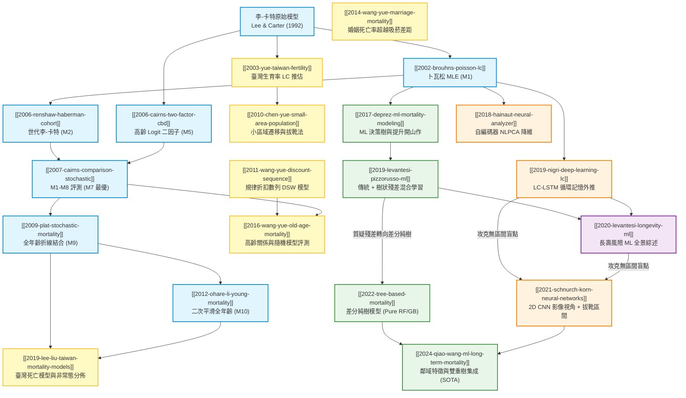
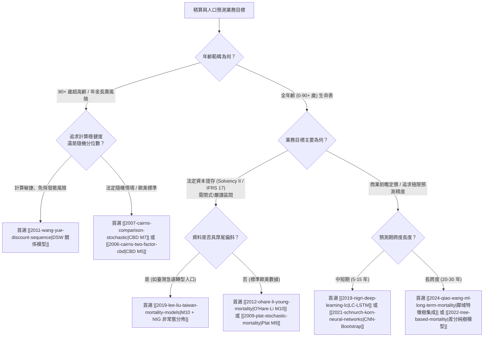

# 隨機死亡率模型與機器學習技術演進對比統整

> **摘要**：本統整專頁針對知識庫收錄的 **20 篇精算人口學、隨機死亡率模型與現代機器學習前沿文獻**（跨越 2002 年至 2024 年）進行全景式橫向對比與演進梳理。內容涵蓋國際古典 [[通用年齡-時期-世代模型 (GAPC)]] 體系、臺灣本土高齡與區域精算實證體系、現代樹狀提升模型，以及深度序列/影像神經網絡。透過全維度對比矩陣、Mermaid 血緣圖、五大學術爭辯與精算實務選型決策樹，建構當代壽命與長壽風險預測之最高密度知識圖譜。

---

## 一、 四大核心學術分支與技術演進脈絡

過去三十年間，精算死亡率與人口推估的研究版圖清晰呈現出四大分支的交互激盪：

### 分支 1：國際古典隨機死亡率模型與 GAPC 體系 (2002–2012)
- **演進路徑**：自 Lee & Carter (1992) 奠基後，[[2002-brouhns-poisson-lc|Brouhns (2002)]] 引進卜瓦松極大概似估計 (MLE) 確立了離散計數標準；[[2006-renshaw-haberman-cohort|Renshaw & Haberman (2006)]] 為 LC 注入出生世代因子 (M2)；[[2006-cairns-two-factor-cbd|CBD (2006)]] 則跳脫對數尺度轉向對數勝算比 ($\text{logit}$) 二因子架構 (M5)，專攻退休長壽風險；[[2007-cairns-comparison-stochastic|Cairns et al. (2007/2009)]] 建立 M1–M8 量化評測標準並確立 M7 最佳穩健性；[[2009-plat-stochastic-mortality|Plat (2009)]] 融合 LC 與 CBD 提出全年齡 M9 模型；最終由 [[2012-ohare-li-young-mortality|O'Hare & Li (2012)]] 以光滑二次項改良為 M10 模型。

### 分支 2：臺灣本土人口推估、高齡關係模型與異質性實證 (2003–2019)
- **演進路徑**：[[2003-yue-taiwan-fertility|余清祥 (2003)]] 首度將 LC 隨機時間序列架構引進臺灣雪崩式下滑的生育率推估；[[2010-chen-yue-small-area-population|陳政勳與余清祥 (2010)]] 確立「小區域人口推估」中淨遷移的主導性與拔靴法；[[2011-wang-yue-discount-sequence|王信忠與余清祥 (2011)]] 突破性地將博弈論規律折扣數列與工程可靠度結合提出高齡 DSW 模型；[[2014-wang-yue-marriage-mortality|王信忠與余清祥 (2014)]] 實證發現臺灣婚姻死亡率差異超越吸菸因子；[[2016-wang-yue-old-age-mortality|王信忠等人 (2016)]] 跨國驗證 DSW 關係模型在 80+ 歲優於傳統隨機模型；[[2019-lee-liu-taiwan-mortality-models|李永琮等人 (2019)]] 則對標西方模型並引進常態反向高斯 (NIG) 等非常態厚尾分配。

### 分支 3：精算機器學習樹狀提升模型 (2017–2024)
- **演進路徑**：[[2017-deprez-ml-mortality-modeling|Deprez et al. (2017)]] 作為開山之作，首度以迴歸決策樹與梯度提升診斷李-卡特殘差與死因死亡率；[[2019-levantesi-pizzorusso-ml|Levantesi & Pizzorusso (2019)]] 與 [[2020-levantesi-longevity-ml|Levantesi et al. (2020)]] 確立了「傳統模型濾波 + 樹擬合殘差」的兩階段混合範式；[[2022-tree-based-mortality|Bjerre (2022)]] 則藉由一階差分平穩化打破偏見，證明「純樹狀模型 (Pure GB/RF)」30 年長期預測勝過傳統與殘差模型；[[2024-qiao-wang-ml-long-term-mortality|喬洋、王昭文等人 (2024)]] 進一步提出空間-世代鄰域特徵與雙重集成，創立超長程長壽預測之 SOTA。

### 分支 4：深度神經網絡降維、序列記憶與區間預測 (2018–2021)
- **演進路徑**：[[2018-hainaut-neural-analyzer|Hainaut (2018)]] 提出以自編碼器 (Autoencoders) 進行非線性主成份分析 (NLPCA)；[[2019-nigri-deep-learning-lc|Nigri et al. (2019)]] 以 LSTM 取代 ARIMA 外推時期因子，預測誤差暴降 40%–91%；[[2021-schnurch-korn-neural-networks|Schnürch & Korn (2021)]] 則從 2D 影像視角出發，以卷積神經網絡 (CNN) 自然捕捉對角線世代特徵，並透過拔靴法攻克了深度學習缺乏預測區間的致命盲點。

---

## 二、 二十篇核心論文技術演進血緣圖 (Mermaid)

---

## 三、 二十篇核心論文全維度橫向對比矩陣 (Master Comparison Matrix)

| 論文代號與年份 | 核心模型與技術架構 | 研究核心問題與動機 | 實證數據集與適用範疇 | 核心實證表現與優勢 | 關鍵侷限性與邊界 |
| :--- | :--- | :--- | :--- | :--- | :--- |
| **[[2002-brouhns-poisson-lc\|Brouhns 2002]]** | 卜瓦松對數雙線性迴歸 (Poisson LC / MLE) | 解決 SVD 高齡異質變異數及二次人為調整問題 | 比利時人口 (1903–1996)，年齡 0–90+ | 一次性極大概似估計，成現代精算 GAPC 標準 | 單一時間因子，無世代效應，長期年齡形狀僵化 |
| **[[2003-yue-taiwan-fertility\|Yue 2003]]** | LC 雙線性架構適配生育率 + ARIMA | 臺灣總生育率雪崩下滑（跌破 1.4），官方定值推估失真 | 臺灣育齡婦女 (1971–2000)，年齡 15–49 | 隨機外推顯著優於 Hadwiger 與 Gamma 參數曲線 | 生育延後使年齡向量 $b_x$ 面臨結構性非線性扭曲 |
| **[[2006-cairns-two-factor-cbd\|Cairns 2006]]** | CBD 二因子模型 ($\text{logit}\, q_{x,t}$ / M5) | 專為年金長壽風險設計，避免外推機率大於 1 | 英格蘭威爾斯 (1947–2002)，高齡 60–89 | 僅 2 個因子無識別困境，MRWD 外推極穩健 | 僅適用 60+ 高齡，完全無法擬合青少年死亡凸起 |
| **[[2006-renshaw-haberman-cohort\|Renshaw 2006]]** | 世代李-卡特模型 ($\text{LC}+\text{Cohort}$ / M2) | 捕捉英國 1925–1945「黃金世代」加速改善特徵 | 英格蘭威爾斯 (1841–2000)，年齡 0–89 | 成功引入出生世代因子，大幅降低殘差自相關 | 概似函數嚴重多峰，極易陷入局部解或不收斂 |
| **[[2007-cairns-comparison-stochastic\|Cairns 2007]]** | 八大隨機死亡率模型對比 (M1–M8, BIC) | 跨國客觀評估模型擬合、預測穩健性與參數風險 | 英美兩國男性數據，高齡 60–89 | 確立 M7 (二次年齡項+世代) 綜合穩健性最高 | 結論局限於英美成熟高齡人口，未含機器學習 |
| **[[2009-plat-stochastic-mortality\|Plat 2009]]** | Plat 全年齡結合模型 (Model M9) | 融匯 LC 全年齡適用性與 CBD 參數穩健性 | 美、英、荷蘭數據，全年齡 0–89 | BIC 大幅領先 LC，克服 M2 世代估計不穩定弊端 | 折線鉸鏈函數 $(\bar{x}-x)^+$ 存在不光滑折點 |
| **[[2010-chen-yue-small-area-population\|Chen & Yue 2010]]** | 小區域人口要素變動法 + 區塊拔靴法 | 全國推估掩蓋地方老化失衡，小區域隨機雜訊大 | 臺北市、雲嘉、澎湖 (1981–2006) | 證實淨遷移為主導變數，放寬相依性使區間增50% | 極高齡人口數據存在零死亡膨脹問題 |
| **[[2011-wang-yue-discount-sequence\|Wang & Yue 2011]]** | 規律折扣數列比值韋伯模型 (DSW) | 80+ 歲高齡死亡率雜訊劇烈，傳統經驗公式僵硬 | 臺、日、美三國 (1970–2007)，高齡 65+ | 理論證明統攝四大經典壽命假說，80+ 預測勝 LC | 僅適用單調老化高齡人口，不可外推全年齡 |
| **[[2012-ohare-li-young-mortality\|O'Hare 2012]]** | 歐海爾-李二次全年齡模型 (Model M10) | 克服 Plat 折點缺陷，平滑涵蓋幼年與意外凸起 | 多國男性數據 (1950–2006)，全年齡 0–89 | 二次項取代折線，成參數化全年齡最優模型 | 結構含三個時期因子與一個世代因子，數據需求高 |
| **[[2014-wang-yue-marriage-mortality\|Wang & Yue 2014]]** | 婚姻分組對數雙線性模型 + 相對風險比 | 探討婚姻狀態是否可作為精算核保定價風險因子 | 臺灣內政部人口檔 (1974–2011)，20+ 歲 | 壯年離婚男性死亡為有偶 3 倍，差距超越吸菸因子 | 無法完全剔除健康選擇效應之內生反向因果 |
| **[[2016-wang-yue-old-age-mortality\|Wang et al. 2016]]** | 高齡關係模型 vs. 隨機模型交叉驗證 | 評估 DSW 關係模型相對於 LC、RH、CBD 之實力 | 臺、日、美三國 HMD 單齡與五齡高齡組 | DSW 餘命預測媲美複雜隨機模型且完全無收斂問題 | 偏重經驗平滑點預測，隨機情境生成成本較高 |
| **[[2017-deprez-ml-mortality-modeling\|Deprez 2017]]** | 機器學習迴歸樹與梯度提升 (CART / GB) | 診斷李-卡特殘差結構缺失與死因死亡率建模 | 瑞士歷史人口與五大死因 (1970–2014) | 首度引進 ML 於精算死亡率，自動捕捉非線性缺陷 | 僅作樣本內診斷與擬合，未處理 30 年外推 |
| **[[2018-hainaut-neural-analyzer\|Hainaut 2018]]** | 自編碼器非線性主成份分析 (NLPCA) | 克服古典 SVD/PCA 只能進行線性降維之幾何限制 | 美、英、法、比多維死亡率曲面數據 | 以少量神經元捕捉複雜年齡形變，降維均方差大減 | 隱藏層權重黑盒子，年齡分組邊界易產生跳躍 |
| **[[2019-lee-liu-taiwan-mortality-models\|Lee et al. 2019]]** | 臺灣死亡模型對比 + 非常態分佈 (NIG/VG) | 西方模型在臺灣急遽老化之適用性與厚尾風險 | 臺灣 HMD 數據 (1970–2014)，年齡 20–89 | NIG/偏斜 t 分配顯著勝出常態；男 Mc-2、女 M9 最佳 | 限於總體人口，未考慮保險組合之基準風險 |
| **[[2019-levantesi-pizzorusso-ml\|Levantesi 2019]]** | 傳統精算模型 + 隨機森林/提升殘差混合 | 消除傳統模型殘差殘留的跨截面非線性相關 | 義、西、加三國人口，年齡 0–99 | 兩階段架構在短中期回測中系統性降低 RMSE | 高齡退休段可能過度配適歷史雜訊 (Bjerre 批判) |
| **[[2019-nigri-deep-learning-lc\|Nigri 2019]]** | 李-卡特模型 + 長短期記憶網絡 (LC-LSTM) | 解決時期因子 $\kappa_t$ 隨機游走無法記憶長期非線性問題 | 義大利等多國數據 (1900–2014)，年齡 0–90+ | 跨國 12 組序列預測誤差暴降 40% 至 91% | 本質為點預測，缺乏封閉解析之機率信賴區間 |
| **[[2020-levantesi-longevity-ml\|Levantesi 2020]]** | 機器學習長壽風險文獻綜述 (State-of-the-Art) | 梳理 AI 在精算壽險之現狀、監理挑戰與基準風險 | 廣泛文獻調研（歐洲精算學界核心成果） | 系統建構「無監督降維 vs 監督擬合」之精算圖譜 | 概念綜述性質，無單一統一代碼橫向基準實測 |
| **[[2021-schnurch-korn-neural-networks\|Schnürch 2021]]** | 卷積神經網 (CNN) 2D 影像網格 + 殘差拔靴法 | 攻克深度學習「只能點預測、無區間估計」之致命阿基里斯之腱 | 美、英、法等成熟國家歷史死亡率數據 | 對角卷積自動捕捉世代；拔靴區間合規 Solvency II | 拔靴需重訓千次網絡，算力開銷極為龐大 |
| **[[2022-tree-based-mortality\|Bjerre 2022]]** | 差分轉換下純樹狀模型 (Pure GB/RF, MCS) | 挑戰「殘差必勝論」，探討純 ML 是否能長程外推 | 33 國 HMD 人口數據 (1850–2019)，30年回測 | 純樹 30 年預測全面擊敗 9 大傳統模型，inTrees 解構歷史 | 本質為階梯函數，完全依賴一階差分平穩化 |
| **[[2024-qiao-wang-ml-long-term-mortality\|Qiao & Wang 2024]]** | 空間-世代鄰域特徵 + 雙重樹集成 (SOTA) | 解決超長程外推收縮問題與小人口單一數據不足 | 全球多大洲 HMD 跨國數據，20–30年外推 | 20 年外推 MAPE 降低近半，泛化穩定度全面超越 CNN/LSTM | 鄰域窗口與集成超參數搜索空間極大 |

---

## 四、 五大核心學術爭端與技術辯論

### 1. 純機器學習 (Pure ML) vs. 傳統-ML 殘差混合 (Residual ML)
- **爭端演進**：[[2017-deprez-ml-mortality-modeling|Deprez (2017)]] 與 [[2019-levantesi-pizzorusso-ml|Levantesi (2019)]] 主張機器學習應作為輔助工具擬合傳統殘差；但 [[2022-tree-based-mortality|Bjerre (2022)]] 指出殘差混合在 59–89 歲退休人口會產生累積誤差過配，只要將死亡率一階差分平穩化，純隨機梯度提升（Pure GB）在外推表現上全面勝出；[[2024-qiao-wang-ml-long-term-mortality|喬洋、王昭文等人 (2024)]] 則進一步證明，加入鄰域特徵的純樹集成架構可進一步將長程誤差降低 30%–50%，奠定了純機器學習的主導地位。

### 2. 關係模型 (DSW) vs. 隨機模型 (GAPC) 在高齡長壽風險之爭
- **爭端演進**：西方學界主流偏向隨機 GAPC 模型（如 CBD M5/M7）；臺灣學者 [[2011-wang-yue-discount-sequence|王信忠與余清祥 (2011, 2016)]] 證明關係模型若引進規律折扣數列與工程韋伯分佈（DSW），在 80 歲以上超高齡群體不僅預測能力優於 Lee-Carter，且完全免除了隨機模型參數多峰與數值不收斂的困擾。

### 3. 點預測精度 vs. 法定監理區間估計 (Solvency II Compliance)
- **爭端演進**：LSTM（[[2019-nigri-deep-learning-lc|Nigri 2019]]）點預測精度極高但無法直接輸出變異數；[[2021-schnurch-korn-neural-networks|Schnürch & Korn (2021)]] 藉由殘差拔靴法 (Bootstrapping) 成功建立了深度學習的經驗預測信賴區間，使 AI 模型首度具備通過歐盟償付能力二號 (Solvency II) 內部模型審計之可行性。

### 4. 2D 影像視角 (CNN) vs. 表格樹集成 (Tree Boosting)
- **爭端演進**：Schnürch & Korn (2021) 將死亡曲面視為圖像，利用 CNN 卷積核提取對角線世代；Qiao & Wang (2024) 則吸收其空間鄰域思想轉化為表格特徵，以雙重樹集成（Bagging+Boosting）在長程外推中展現出高於 CNN 的穩定度與樣本效率。

### 5. 西方人口模型 vs. 亞洲急遽轉型人口（臺灣實證）
- **爭端演進**：歐美模型多假設高斯白雜訊；臺灣學者實證（[[2019-lee-liu-taiwan-mortality-models|Lee et al. 2019]]）證實臺灣資料具備顯著的厚尾跳躍特性，必須採用常態反向高斯 (NIG) 分配；同時婚姻狀態（[[2014-wang-yue-marriage-mortality|Wang & Yue 2014]]）與小區域淨遷移（[[2010-chen-yue-small-area-population|Chen & Yue 2010]]）對死亡與人口結構的衝擊甚至超越傳統變數。

---

## 五、 精算實務決策樹與模型選型指南 (Practitioner Selection Guide)

---

## 六、 知識庫關聯專頁彙整

- **20 篇單篇論文筆記**：
  - [[2002-brouhns-poisson-lc]]、[[2003-yue-taiwan-fertility]]、[[2006-cairns-two-factor-cbd]]、[[2006-renshaw-haberman-cohort]]、[[2007-cairns-comparison-stochastic]]
  - [[2009-plat-stochastic-mortality]]、[[2010-chen-yue-small-area-population]]、[[2011-wang-yue-discount-sequence]]、[[2012-ohare-li-young-mortality]]、[[2014-wang-yue-marriage-mortality]]
  - [[2016-wang-yue-old-age-mortality]]、[[2017-deprez-ml-mortality-modeling]]、[[2018-hainaut-neural-analyzer]]、[[2019-lee-liu-taiwan-mortality-models]]、[[2019-levantesi-pizzorusso-ml]]
  - [[2019-nigri-deep-learning-lc]]、[[2020-levantesi-longevity-ml]]、[[2021-schnurch-korn-neural-networks]]、[[2022-tree-based-mortality]]、[[2024-qiao-wang-ml-long-term-mortality]]
- **核心概念專頁 (Concepts)**：
  - [[李-卡特模型 (Lee-Carter Model)]]、[[通用年齡-時期-世代模型 (GAPC)]]、[[世代效應 (Cohort Effect)]]、[[長壽風險 (Longevity Risk)]]
  - [[模式信賴集合 (Model Confidence Set, MCS)]]、[[隨機森林 (Random Forests)]]、[[隨機梯度提升 (Stochastic Gradient Boosting)]]、[[長短期記憶網路 (Long Short-Term Memory, LSTM)]]
  - [[折扣數列模型 (Discount Sequence Model, DS 與 DSW)]]、[[卷積神經網路於死亡率預測 (Convolutional Neural Networks for Mortality, CNN)]]、[[小區域人口推估 (Small Area Population Projection)]]
